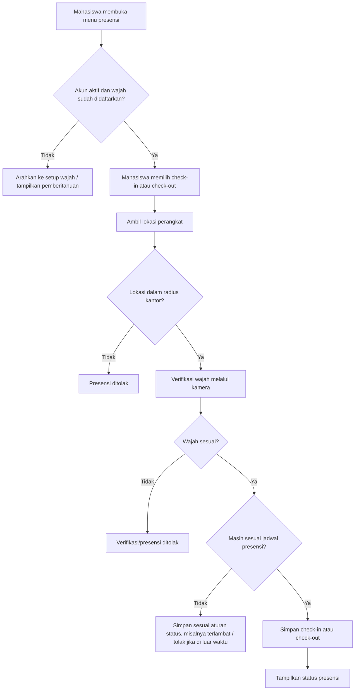
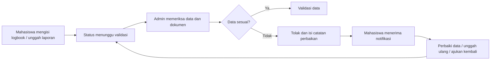

# Identifikasi Kebutuhan Pengguna, Alur Proses, dan Perencanaan Modul Utama Sistem

## 1. Gambaran Sistem

Sistem ini merupakan aplikasi monitoring magang berbasis web untuk mengelola peserta magang pada beberapa instansi. Sistem mendukung presensi dengan lokasi dan verifikasi wajah (*face recognition*), pencatatan aktivitas harian, pengumpulan laporan, pembimbingan, penilaian, sertifikat, serta rekap administrasi. Akses pengguna dibedakan berdasarkan peran dan kategori instansi agar data tiap instansi terisolasi.

## 2. Identifikasi Kebutuhan Pengguna

| Pengguna | Kebutuhan utama |
| --- | --- |
| Pengunjung publik | Melihat informasi sistem/instansi, statistik dan daftar peserta magang aktif. |
| Mahasiswa/peserta magang | Mengelola profil dan bidang/divisi, mendaftarkan wajah, melakukan presensi, mencatat logbook, mengunggah laporan, mengajukan pembimbing, memantau status validasi, mengunduh rekap presensi, dan mengunduh sertifikat setelah dinilai. |
| Admin instansi | Mengelola data mahasiswa, dosen/pembimbing, presensi, logbook, laporan, pengajuan pembimbing, permintaan reset wajah, penilaian, sertifikat, ekspor data, serta konfigurasi instansi dan jadwal presensi. |
| Pembimbing | Memantau mahasiswa bimbingan, melihat detail kegiatan/presensi, serta mengunduh rekap presensi dan logbook mahasiswa. |
| Master admin | Mengelola daftar instansi/kategori instansi dan pengaturan global sistem. |

### Kebutuhan fungsional

1. Sistem menyediakan autentikasi, verifikasi email, pengelolaan profil, dan pembatasan akses berbasis peran.
2. Data mahasiswa, pembimbing, logbook, laporan, presensi, dan penilaian dipisahkan menurut kategori instansi.
3. Mahasiswa dapat melakukan check-in dan check-out sekali per hari pada jam operasional yang ditentukan instansinya.
4. Presensi mengharuskan lokasi perangkat berada dalam radius kantor dan verifikasi wajah berhasil sebelum tindakan presensi diproses.
5. Mahasiswa dapat mendaftarkan data wajah dan mengajukan reset wajah apabila diperlukan; admin memutuskan permohonan tersebut.
6. Mahasiswa dapat membuat, mengubah, menghapus, dan mengekspor logbook; admin dapat memvalidasi atau menolak logbook dengan catatan perbaikan.
7. Mahasiswa dapat mengunggah, melihat, mengunduh, memperbarui, mengajukan kembali, atau menghapus laporan; admin dapat memvalidasi atau menolaknya.
8. Mahasiswa dapat mengajukan dosen pembimbing yang sudah tersedia atau mengusulkan dosen baru; admin dapat menyetujui atau menolak pengajuan.
9. Admin dapat membuat penilaian enam aspek, menghitung total/rata-rata/nilai huruf, menyimpan scan sertifikat, dan menghasilkan sertifikat PDF.
10. Sistem menyediakan rekap dan ekspor PDF/CSV untuk kebutuhan monitoring serta administrasi.

### Kebutuhan nonfungsional

1. Keamanan: kata sandi disimpan aman, akses dibatasi berdasarkan peran, dan data antarinstansi tidak dapat diakses sembarangan.
2. Keandalan data: validasi input, pencatatan status persetujuan/penolakan, serta penyimpanan bukti dokumen.
3. Kemudahan penggunaan: antarmuka responsif, pesan status yang jelas, dan notifikasi ketika logbook atau laporan ditolak.
4. Kinerja: daftar data menggunakan paginasi dan pencarian untuk membantu pengelolaan peserta dalam jumlah besar.
5. Integrasi perangkat: aplikasi perlu mendapat izin kamera dan lokasi dari browser untuk presensi berbasis wajah dan geolokasi.

## 3. Penyusunan Alur Proses

### A. Alur utama peserta magang

1. Mahasiswa mendaftar atau akun dibuat oleh admin, kemudian login dan melengkapi profil/bidang.
2. Mahasiswa melakukan *setup* wajah melalui kamera; sistem menyimpan representasi wajah untuk verifikasi berikutnya.
3. Mahasiswa mengajukan pembimbing. Admin memeriksa pengajuan dan menyetujui atau menolak. Jika disetujui, mahasiswa dihubungkan dengan pembimbing.
4. Setiap hari kerja, mahasiswa membuka menu presensi. Sistem memeriksa status akun, jadwal hari itu, lokasi dalam radius kantor, dan verifikasi wajah.
5. Jika seluruh pemeriksaan berhasil, sistem menyimpan check-in. Pada waktu pulang, prosedur yang sama dijalankan untuk check-out.
6. Mahasiswa mencatat kegiatan melalui logbook dan mengunggah laporan sesuai kebutuhan.
7. Admin memeriksa logbook/laporan. Data yang valid ditandai tervalidasi; data yang ditolak dikembalikan bersama catatan untuk diperbaiki dan diajukan kembali.
8. Setelah masa magang selesai, admin menginput penilaian. Sistem menghitung hasil dan membuat sertifikat; mahasiswa dapat mengunduh sertifikatnya.

### B. Alur presensi berbasis wajah dan lokasi

### C. Alur validasi logbook dan laporan

### D. Alur penilaian dan sertifikat

1. Admin membuka data mahasiswa yang telah menyelesaikan magang.
2. Admin mengisi nomor dan tanggal sertifikat, enam aspek nilai, apresiasi khusus, serta scan sertifikat bila tersedia.
3. Sistem menghitung total, rata-rata, dan predikat huruf secara otomatis.
4. Penilaian disimpan, status mahasiswa menjadi nonaktif/selesai, dan sertifikat PDF dapat dibuat.
5. Mahasiswa mengunduh sertifikat dari akun masing-masing.

## 4. Perencanaan Modul Utama Sistem

| Modul | Fungsi utama | Pengguna |
| --- | --- | --- |
| Autentikasi dan otorisasi | Registrasi, login, verifikasi email, reset kata sandi, profil, serta akses berbasis peran. | Semua pengguna terdaftar |
| Master instansi dan pengaturan | Kelola instansi, identitas aplikasi, lokasi kantor, radius presensi, jadwal kerja, dan informasi publik. | Master admin, admin instansi |
| Manajemen mahasiswa | Tambah, ubah, nonaktifkan, cari, lihat detail, dan ekspor data peserta magang. | Admin instansi |
| Manajemen pembimbing | Kelola data pembimbing, relasi pembimbing-mahasiswa, dan persetujuan pengajuan pembimbing. | Mahasiswa, admin, pembimbing |
| Verifikasi wajah | Pendaftaran descriptor wajah, verifikasi kamera sebelum presensi, dan permintaan/reset wajah. | Mahasiswa, admin |
| Presensi | Check-in/out berbasis jadwal, GPS/radius kantor, status hadir atau terlambat, riwayat, dan rekap PDF. | Mahasiswa, admin, pembimbing |
| Logbook | Pencatatan kegiatan harian, perubahan/penghapusan, validasi/penolakan, dan ekspor PDF. | Mahasiswa, admin, pembimbing |
| Laporan magang | Unggah, pratinjau, unduh, perbaikan, pengajuan ulang, serta validasi/penolakan laporan. | Mahasiswa, admin |
| Penilaian dan sertifikat | Input enam aspek penilaian, perhitungan nilai, scan sertifikat, serta pembuatan sertifikat PDF. | Admin, mahasiswa |
| Dashboard dan pelaporan | Statistik peserta, rekap absensi, status dokumen, daftar bimbingan, ekspor CSV/PDF, dan informasi publik. | Admin, pembimbing, master, publik |

## 5. Prioritas Implementasi

1. **Prioritas tinggi:** autentikasi/otorisasi, master data instansi dan mahasiswa, presensi wajah-lokasi, serta logbook.
2. **Prioritas menengah:** laporan dan validasi, pembimbingan, rekap/ekspor, penilaian serta sertifikat.
3. **Prioritas pengembangan:** notifikasi real-time, audit aktivitas, integrasi API mobile, dashboard analitik, dan pengingat jadwal presensi atau laporan.

Dokumen ini disusun berdasarkan implementasi aplikasi yang tersedia, termasuk rute web, model data, dan modul presensi berbasis `face-api.js`.
